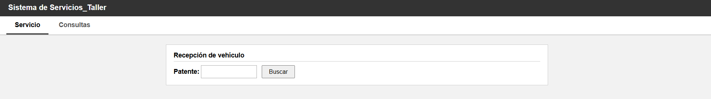
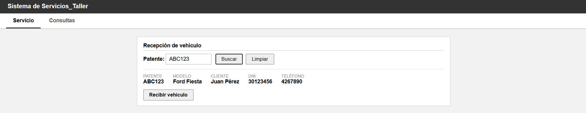
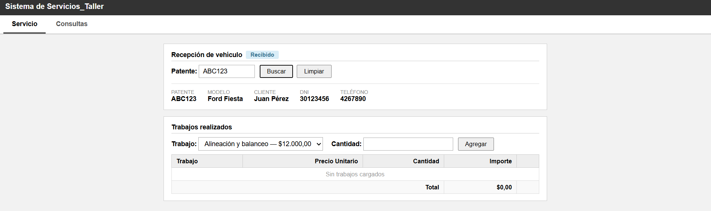
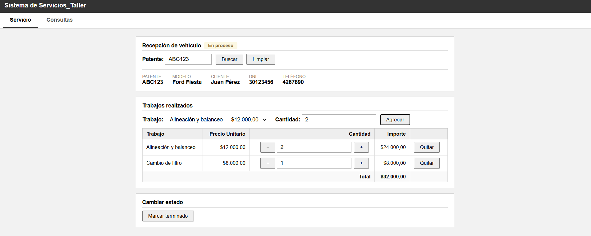
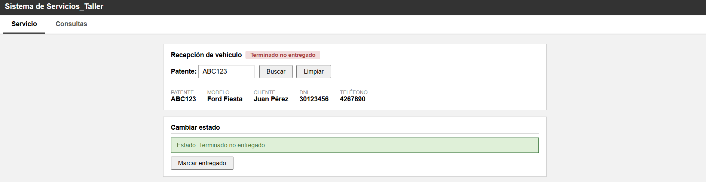
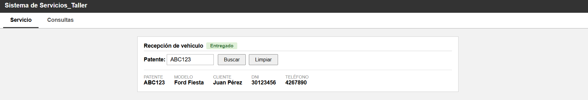
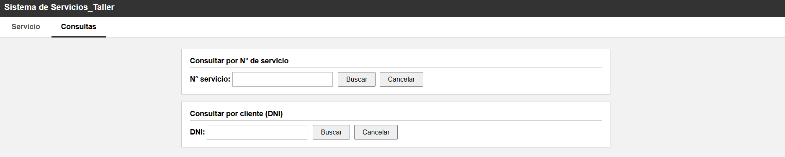
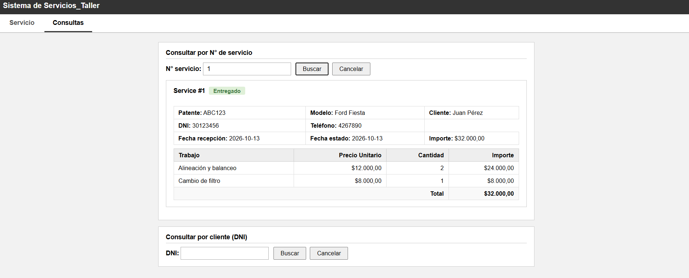
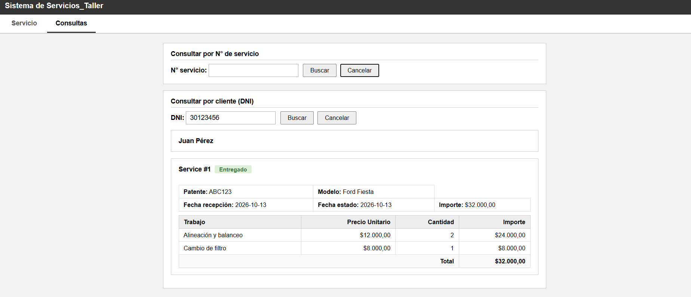

# sistema_taller_mecanico
## Descripcion

Este proyecto fue desarrollado como un trabajo final para la materia Algoritmo y estructura de datos 3 de la carrera Analista de Sistemas.
El sistema permite administrar clientes,vehiculos,servicios y trabajos realizados de un taller mecanico mediante una aplicacion web.
Su objetivo es facilitar el seguimiento de cada reparacion desde la recepcion del vehiculo hasta su entrega.

---

## Funcionalidades

- Registro de clientes
- Registro de vehiculos
- Recepcion de vehiculos 
- Gestion de ordenes de servicio
- Registro de trabajos realizados 
- Cambio del estado del servicio
- Consulta por numero de servicio
- Consulta por cliente
- Calculo automatico del importe

---

## Tegnologias utilizadas 

- PHP
- JavaScript
- AJAX
- JQuery
- JSON
- HTML
- CSS
- WAMP

---

## Base de datos

La aplicacion utiliza MySQL con una base de datos relacional compuesta por tablas como:

- Clientes
- Vehiculos
- Modelos 
- Trabajos
- Servicios
- Servicios_detalle

---

## Conocimientos aplicados

- Programación orientada a objetos en PHP
- Diseño y utilización de bases de datos relacionales
- Consultas SQL
- CRUD
- Manejo de sesiones
- AJAX y JSON
- Manipulación del DOM con JavaScript/jQuery
- Validación de datos
- Organización del código en clases
  
---

## Capturas de pantalla

### Pantalla de inicio

### Recibir vehiculo

### Agregar servicio

### Servicio cargado

### Servicio finalizado

### Vehiculo entregado

### Consultas

### Consultar servicio

### Consultar DNI

---

## 👩‍💻 Autora

Priscilla Guerrero
